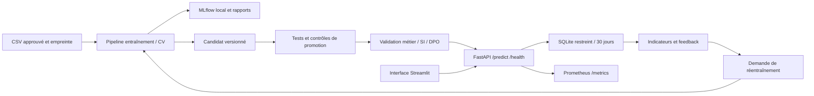

# Architecture et exploitation

## Composants et décisions

- **Pipeline sklearn complet** : mêmes transformations entraînées et utilisées en service, persistance joblib avec empreinte. Ne charger que des artefacts de confiance : un hash adjacent assure l'intégrité accidentelle, pas une signature contre un attaquant qui remplace les deux fichiers.
- **FastAPI/Pydantic** : contrat documenté dans OpenAPI, types stricts et erreurs 422 ; traitement clair des profils hors distribution. /health vérifie que le modèle a été chargé au démarrage.
- **MLflow** : un run réel local trace les paramètres, métriques et fichiers. Les 20 configurations et 60 folds figurent dans les CSV attachés au run ; il ne s'agit pas de 60 runs MLflow distincts.
- **Streamlit** : formulaire, résultats de l'étude, suivi et retour observé. Interface locale destinée à la démonstration ; l'API reste indépendante.
- **SQLite** : suffisant pour un seul processus de démonstration. Plusieurs workers nécessiteraient une base partagée et une file de tâches distribuée. /train utilise une tâche en arrière-plan et un verrou par processus ; un redémarrage n'assure pas la reprise d'une tâche interrompue.
- **Prometheus** : compteurs par route/status et histogramme de latence. Les données personnelles ne sont pas des labels de métriques. Le scrape authentifié nécessite un bearer token dans la configuration du collecteur.

## Contrat d'inférence

POST /predict exige exactement les huit variables de S4. Pas de duration ni de données démographiques. Un type invalide ou une catégorie hors dictionnaire donne 422. Une catégorie métier valide mais jamais vue, ou une valeur numérique hors plage d'entraînement, donne HTTP 200 avec `abstain=true`, `probability=null` et `human_review`. Une probabilité située à ±0,03 du seuil déclenche aussi l'abstention. Cette marge est une règle d'exploitation proposée, pas un intervalle de confiance statistique.

Pour la reprise humaine : file de revue du responsable de campagne, objectif proposé d'un jour ouvré, vérification manuelle de l'éligibilité et du contexte. Le prototype expose l'action et la traçabilité ; il ne crée pas de ticket dans un SI externe. Aucun appel n'est déclenché par l'API.

Le test temporel final est entièrement hors des plages d'entraînement : **couverture du service = 0 %**. Les métriques du modèle calculées sur le bloc final sont donc des métriques hors filtre, et ne doivent jamais être présentées comme des performances de décisions réellement émises par le service. La recommandation est de **ne pas déployer** ce candidat.

## Hébergement et ressources

Hypothèse de départ : VM Linux sur site bancaire ou fournisseur répondant aux exigences de localisation et de contrôle du SI, 2 vCPU, 2 Go RAM, disque chiffré. CPU suffit pour 100 arbres de profondeur maximale 8 ; pas de besoin démontré de GPU. Ces ressources sont une proposition, pas le résultat d'un test de charge. Le p95 local est mesuré séparément pour le modèle et pour l'API ASGI ; il ne mesure ni réseau, ni TLS, ni concurrence.

Le Dockerfile utilise un utilisateur non privilégié ; compose lie le port à localhost, limite CPU/RAM, retire les capacités et impose un secret. Le serveur réel nécessite reverse proxy TLS, identité d'entreprise, supervision et sauvegarde. Le choix on-premise minimise les transferts ; un cloud ne devient pas « souverain » par simple déclaration : vérifier contrats, accès, sous-traitants et localisation avec SI/DPO.

## Métriques, alertes et actions

| Indicateur | Fréquence proposée | Seuil de revue | Action |
|---|---|---|---|
| Latence p95 | 5 min | > 500 ms | Examiner charge, I/O et artefact ; pas de réentraînement automatique |
| Erreurs HTTP 5xx | 5 min | > 1 % | Alerte exploitation, rollback si lié à une version |
| Disponibilité | Mensuel | < 99,5 % | Revue incidents ; objectif proposé, non mesuré ici |
| PSI des entrées | ≥ 100 requêtes, fenêtre 30 j | > 0,2 | Investiguer dérive ; PSI n'est pas une preuve de concept drift |
| AP avec labels retardés | ≥ 200 labels et deux classes | baisse > 0,05 vs référence de validation | Demander un entraînement candidat |
| Calibration / Brier | Mensuel avec labels | dégradation vs référence | Examiner prévalence, calibration et qualité des retours |
| Abstention / OOD | Chaque lot | évolution forte ou couverture < 80 % | Suspendre usage et analyser la représentativité |
| Erreurs par groupe | Mensuel | écarts à instruire, petits effectifs signalés | Revue métier/DPO ; ne pas conclure sur un seul petit groupe |

Les seuils de couverture de 80 % et d'écart d'erreurs de 20 points sont des **contrôles pédagogiques ajoutés lors de la revue des résultats**. Ils n'ont pas servi à sélectionner le modèle et ne sont pas présentés comme des seuils préenregistrés ni comme des normes légales. Pour de futures versions, les figer avant entraînement. Le protocole initial figure dans `config/protocol.json`.

## Feedback et amélioration

POST /feedback relie yes/no à un request_id. Une correction contradictoire est refusée (409) pour éviter un remplacement silencieux. Le score et la version permettent d'évaluer les prédictions après arrivée des résultats. Les clients non contactés ont souvent un label non observé : ne jamais convertir automatiquement cette absence en « non ». Prévoir une évaluation prospective ou un échantillon de contrôle avec validation métier et conformité. L'API ne réentraîne pas sur un simple clic de retour.

/monitoring calcule l'indicateur de réentraînement ; /train, authentifié, prend un CSV déjà approuvé sur disque, refuse le même hash que le jeu d'examen, entraîne un **candidat séparé** et expose /jobs/{id}. Le champion n'est jamais remplacé par cette route. La CI planifiée permet de traiter un snapshot configuré chaque semaine ; sans configuration, elle n'exécute rien. Réexaminer les indicateurs avec métier/DPO chaque trimestre.

## CI/CD et rollback

`ci.yml` compile le code et exécute les tests sur données synthétiques. `candidate.yml` acquiert un snapshot approuvé avec hash, entraîne, évalue et archive les preuves, puis applique les critères de promotion. Une fois les gates passés, le job de déploiement utilise l'environnement GitHub `production` (configurer ses approbateurs), construit une image et l'envoie à l'hôte configuré via SSH vérifié. Aucun hôte ni secret n'a été configuré ou contacté dans cette session.

Préparer `/opt/atlas/release.sh` et `api.env` hors Git. Le script charge l'image, démarre le conteneur, vérifie /health et rétablit l'image précédente en cas d'échec. Cette procédure crée une brève interruption ; pour un service critique, préférer bleu/vert derrière le proxy. Les jobs conservent les rapports, le hash et l'image identifiée par le commit. Tester le rollback en préproduction avant toute promotion réelle.

Le candidat actuel échoue aux contrôles de production : le pipeline doit s'arrêter. Une CI verte sur les tests logiciels ne rend pas un modèle exploitable.
